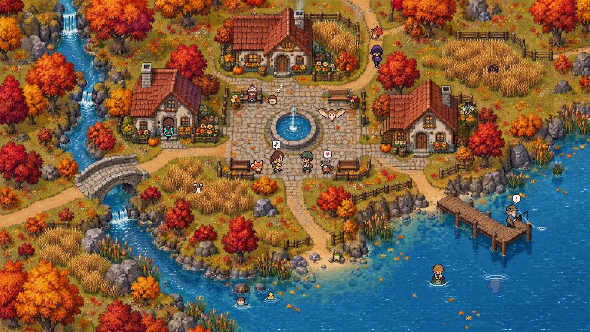
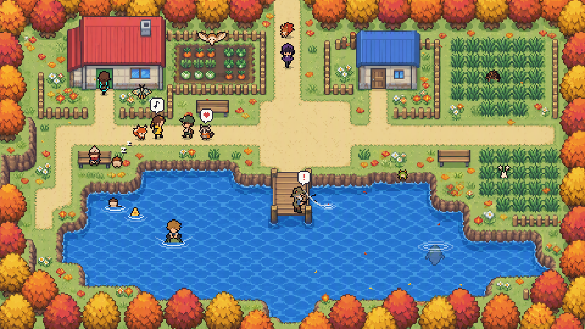
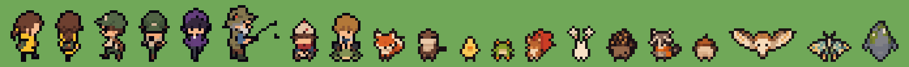

# Ideas for later looks

Looks Truman wants that need new code before the autopilot can make them. Each has an entry in [config/aesthetics.json](../config/aesthetics.json) with tier `idea` and a `needs` list of files. `new_video.py plan`, and so the autopilot, stops on such a look until those files exist. When he asks for one, tell him what it needs and offer to build it as its own project. Don't squeeze the idea into another look.

## Critter town

Truman, 2026-10-21: Pokémon-style relax videos where only the top-down landscape is generated, and simple creature and trainer sprites, animated in code, move around it: a bit more dynamic, still calm.

A calm top-down village in the modern indie pixel-RPG style, with the feel of a monster-collecting game's overworld and a look of its own. Only the map is AI art. Our own creatures and kids are pixel sprites animated in code: they walk the paths, follow each other, fish off the pier, sit on benches, go in and out of doors, greet, swim, ride a big creature across the pond, rustle through tall grass and fly over. Leaves fall the whole time.

Status: concept only. He picked the modern style and will build it in a new session (2026-10-21).

Concept stills (2026-10-21, not renders):

Made with `tools/critter_concept.py` for $0.26: two maps and two sprite sheets from gpt-image-2-5-sunburst, the sprites converted to each map's pixel grid and placed in code. The sheets and their prompts are in [ideas/critter-town/](ideas/critter-town/); the maps stay in `out/concepts/critter-town/`.

### His answers (2026-10-21)

- Creatures: a mix of real animals (fox kit, otter, duckling, tree frog, barn owl, raccoon kit) and made-up critters (a squirrel with a maple-leaf tail, a bunny with dandelion ears, a pinecone porcupine, an acorn-cap hedgehog, a mossy manatee, a stained-glass moth). All original.
- Map style: the modern one. He first asked for both, then picked from the stills: the modern map looks better and more distinct, and less like a copy of Pokémon, which can't use Pokémon anyway. The handheld style is out.
- Season: autumn with falling leaves.
- What they do: all nine. Follow a kid, fish, sit on benches, use doors, greet, ride a creature across water, rustle in tall grass, swim, fly.
- Music: lofi with soft chiptune touches.

### Rights

- Nothing from Pokémon: no real Pokémon, trainers, Poké Balls, Pokémon Center or Mart, names, logos, maps or music. Our own creatures and kids only.
- Why. He asked how Farm Life Gaming does it (real sprites and the games' music, 307K and 13K views). Nintendo's Game Content Guidelines allow monetized gameplay videos with commentary and exclude "mere copies of ... music ... and art collections"; fan art is outside them. Nintendo blocked thousands of GilvaSunner's game-music uploads in 2022 and the channel closed. Farm Life credits Nintendo and writes "No copyright infringement is intended", which is no license. Three strikes deletes the whole channel, Treetop and the ramen alley included.
- A look of its own too: the modern indie pixel style, never the handheld games' tiles and palette, and no trading-card frames or other nods to theirs on thumbnails.
- Never write "Pokémon" in an image prompt: it pulls in their designs. Leave it out of titles too ("cozy pixel village", "pixel RPG town"); the franchise rule only allows a franchise as a secondary part anyway. Decide with him at upload.
- Kids as small pixel sprites are fine here (his request). The no-people rule is about painted people in key art, and the map stays empty.
- Creatures move only as sprites animated in code, never as generated video (the painted-pet rule).

### What it needs

- `src/library/walkers.js`: sprites on a path graph, walking in 4 directions along the paths, 2 to 3 frame walk cycles at 12 fps, sorted by their feet, behind roofs and canopies, their lower part hidden in tall grass and water, snapped to whole art pixels.
- Seeded timeline events that loop in the 20 minute window: walk, follow, fish (cast, wait, a bite with "!", reel in), sit, nap ("Zz"), door in and out, greet (note, heart, "..." bubbles), ride, swim, wander, fly with a ground shadow.
- Map analysis: the vision model and SAM 2 find paths, doors, benches, the pier's end, tall grass, water, roofs and canopies (like `plate_features.py`), build the walk graph and keep everyone off solid things.
- `tools/sprites.py`: the cast from AI sprite sheets (front, back and side views and walk frames per character), cut by alpha and converted with `to_pixel` from `critter_concept.py`. CC0 sprite packs are the other source. Every sheet in the ledger.
- Water: a slow shimmer, ripple rings, the bobber, a wake behind the rider.
- Falling pixel leaves (`leaves.js` has pixel leaf shapes), some floating on the pond.
- A daytime sound bed `village_day` (birds, breeze in the leaves, lapping water, far chimes, soft footsteps) and a music pool of lofi with soft chiptune.
- Calm: 3 to 6 sprites moving at once, slow walking, no battles, no running, no flashes. They come and go by doors and the map's edges. Locked camera, one screen.
- 768x432 art pixels (x5 at 4K): pixelize the map to it (`plate_prep.pixelize`) and draw the sprites on the same grid. Kids about 29 art pixels tall, creatures 13 to 24 (`modern()` in `critter_concept.py`).

### What the concept taught

- The modern map came out without a clean pixel grid and holds up pixelized to 768x432. The handheld one had a clean 5.32 px grid (480x270 art pixels).
- A kid about 1.4 times a door's height reads right. On the busy modern map that is about 1.3 times the handheld size; smaller, the cast gets lost in the detail.
- In `to_pixel`, dark lines need half of a pixel's footprint to win. At a quarter, faces turn dark.
- A follower walks 1.5 tiles behind. At one tile the squirrel sat on the kid's head like a hat.
- A big swimmer reads best just under the surface, tinted, with rings at its head. Cut off at the waterline it looked like a rock.
- Shadows and rings go on their own layer: drawing RGBA onto an RGBA image in PIL replaces pixels, and a soft shadow came out black.

Cost per video, roughly: a pixel sample plus 6 to 10 sprite sheets at about $0.06 each.
